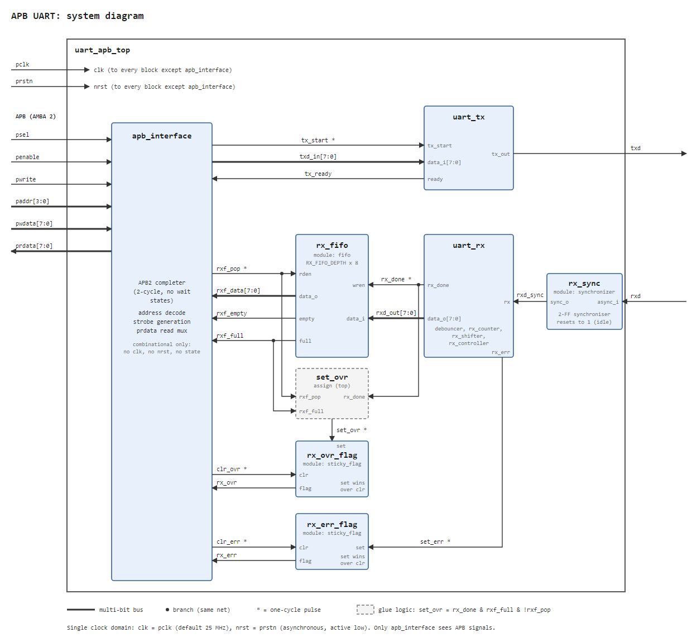

## Overview

In this project, an APB-compliant UART IP is implemented on Lattice Certus-NX Versa Evaluation Board and verified through simulation.

### UART Specifications

For the purpose of this project, the UART is limited to the following specifications:
- Data mode: 8-bit only, not configurable
- Stop bit: 1-bit only, not configurable
- Baud Rate: 9600 by default; fixed at synthesis time (see *Parameters*)
- TX FIFO: none
- RX FIFO: depth of 16 by default; fixed at synthesis time (see *Parameters*)
- Sampling: 1x/bit sampling only

The resulting frame format is 8N1. 

The **RX FIFO Behavior** is shown in detail below. Note that `full` and `empty` are written such that they never assert simultaneously.

| wr | rd | full | empty | behavior |
|-|-|-|-|-|
| `0` | `0` | `x` | `x` | - |
| `0` | `1` | `x` | `0` | valid read; pops oldest byte |
| `1` | `0` | `0` | `x` | writes value to FIFO |
| `1` | `0` | `1` | `0` | no write; FIFO remains full |
| `0` | `1` | `0` | `1` | returns stale, undefined data; FIFO remains empty |
| `1` | `1` | `0` | `0` | pops oldest byte & writes value to FIFO |
| `1` | `1` | `1` | `0` | pops oldest byte & writes value to FIFO; FIFO remains full |
| `1` | `1` | `0` | `1` | writes value to FIFO & returns stale, undefined data; FIFO no longer empty |

### APB Specifications

The UART IP does not implement `PREADY` and `PSLVERR` (APB3). Support for APB3 can be implemented by wrapping the UART IP and tying `PREADY` to `1` and `PSLVERR` to `0`.

The APB data bus is 8 bits wide and the address bus is 4 bits wide. To connect to a 32-bit APB bus, the wrapper zero-extends `prdata` to 32 bits, passes `pwdata[7:0]` to the UART, and passes `paddr[3:0]`; address decoding of the UART's base address is done by the interconnect.

Interrupts are also not implemented.

Errors will be handled as follows:
- **Unmapped address access** - read returns 0, writes are ignored
- **Write to busy TX** - write is ignored
- **RX read when FIFO is empty** - returns stale, undefined data. FIFO will not underflow
- **Framing error on RX byte** - byte is dropped, RX_ERR status flag is raised.
- **Byte received while RX FIFO is full** - byte is dropped, RX_OVR status flag is raised.
    - EXCEPTION: When receive and a read happens in the same cycle, both are accepted & FIFO remains full.

### Clock and reset

All submodules are configured for and run with a 25 MHz source clock (on-board oscillator) and follow asynchronous active-low reset. The only exception is `apb_interface` module, which is purely combinational and has no reset. 

At 25 MHz and 9600 baud rate, the bit period is 2604.17 clock cycles. Rounding down to 2604 CC gives an actual baud rate of 9600.6, which represents a +0.006% error. This is well within the UART protocol's 5% tolerance.

The receiver waits half a bit period, 1302 clock cycles, after detecting the start-bit edge, so that each bit is sampled near its centre.

### Parameters

The design is parameterized. Parameters are set at synthesis time; there is no runtime configuration.

| Parameter | Default | Legal range | Description |
|-|-|-|-|
| `CLKI_FREQ_MHZ` | 25 | integer; see constraint below | frequency of `pclk` in MHz |
| `BAUD_RATE` | 9600 | integer; see constraint below | UART baud rate |
| `RX_FIFO_DEPTH` | 16 | power of 2, 2 or more | number of bytes the RX FIFO holds |

Constraint: the bit-period count, `CLKI_FREQ_MHZ` × 10^6 / `BAUD_RATE` rounded down, must not exceed 65535 (16-bit bit-period counter). The resulting baud error should be checked as in *Clock and reset*.

The address width (4 bits) and data width (8 bits) are fixed by the register map and are not parameters.

### Port table

| Port | Dir | Width | Description |
|-|-|-|-|
| `pclk` | in | 1 | module clock; must match `CLKI_FREQ_MHZ` (default 25 MHz) |
| `prstn` | in | 1 | asynchronous active-low reset |
| `paddr` | in | 4 | APB address signal |
| `psel` | in | 1 | APB select signal |
| `penable` | in | 1 | APB enable signal |
| `pwrite` | in | 1 | APB write signal |
| `pwdata` | in | 8 | APB write data signal |
| `prdata` | out | 8 | APB read data signal |
| `rxd` | in | 1 | incoming UART signal |
| `txd` | out | 1 | outgoing UART signal; `1` on reset |

### System Diagram

### Register Map

Registers are 8 bits wide and word-aligned. The register is selected by `paddr[3:2]`; `paddr[1:0]` are ignored.

The APB interface holds no state. Every transfer completes with no wait states, and its side effects take place in the access phase (`psel` and `penable` high), once per transfer:
- A write to `TXDATA` passes `pwdata` directly to the transmitter, which latches the byte when the write is accepted (`TX_READY` = 1).
- A read of `RXDATA` drives the FIFO output onto `prdata` and pops the FIFO at the end of the access phase, unless the FIFO is empty.
- A write to `STATUS` clears `RX_OVR` if `pwdata[3]` = 1 and `RX_ERR` if `pwdata[4]` = 1. The flags are held outside the APB interface.
- `prdata` is driven combinationally from `paddr[3:2]`, the FIFO output and the status signals.

| Offset | Name | Access | Reset | Description |
|-|-|-|-|-|
| `0x0` | `TXDATA` | WO | `0x00` | `[7:0]` byte to transmit. Write is ignored unless `TX_READY` = 1. Read returns 0 |
| `0x4` | `RXDATA` | RO, read pops FIFO | `0x00` | `[7:0]` oldest received byte. Read when FIFO is empty returns undefined data and does not pop. Write is ignored |
| `0x8` | `STATUS` | RO, bits 3 and 4 W1C | `0x03` | see bit fields below. Writing 1 to bit 3 or bit 4 clears that flag; writes to other bits are ignored |
| `0xC` | unmapped | - | - | read returns 0, write is ignored |

The `STATUS` register bit fields are as follows:

| Bit | Name | Access | Reset | Description |
|-|-|-|-|-|
| 0 | `TX_READY` | RO | 1 | transmitter is idle; a write to `TXDATA` is accepted |
| 1 | `RX_EMPTY` | RO | 1 | RX FIFO holds no bytes |
| 2 | `RX_FULL` | RO | 0 | RX FIFO holds `RX_FIFO_DEPTH` bytes |
| 3 | `RX_OVR` | W1C | 0 | byte received while RX FIFO full with no read request. Set takes priority over clear | 
| 4 | `RX_ERR` | W1C | 0 | byte received with a bad stop bit (framing error). Set takes priority over clear |
| 7:5 | reserved | RO | 0 | - |

### Limitations

- **1x sampling only** - each bit is sampled only once, near its centre. Oversampling or majority vote is not implemented.
- **No runtime configuration** - clock frequency, baud rate and FIFO depth are fixed at synthesis time.
- **8N1 only** - no parity and no 2-stop-bit support.
- **No TX FIFO** - software must wait for `TX_READY` before writing each byte.
- **No interrupts** - software must poll `STATUS`.
- **No APB wait states or error responses** - `PREADY` and `PSLVERR` are not implemented.
- **Simulation only** - the design is verified in simulation; it is not tested on hardware.

## References

ARM IHI 0011A, Chapter 5: AMBA APB